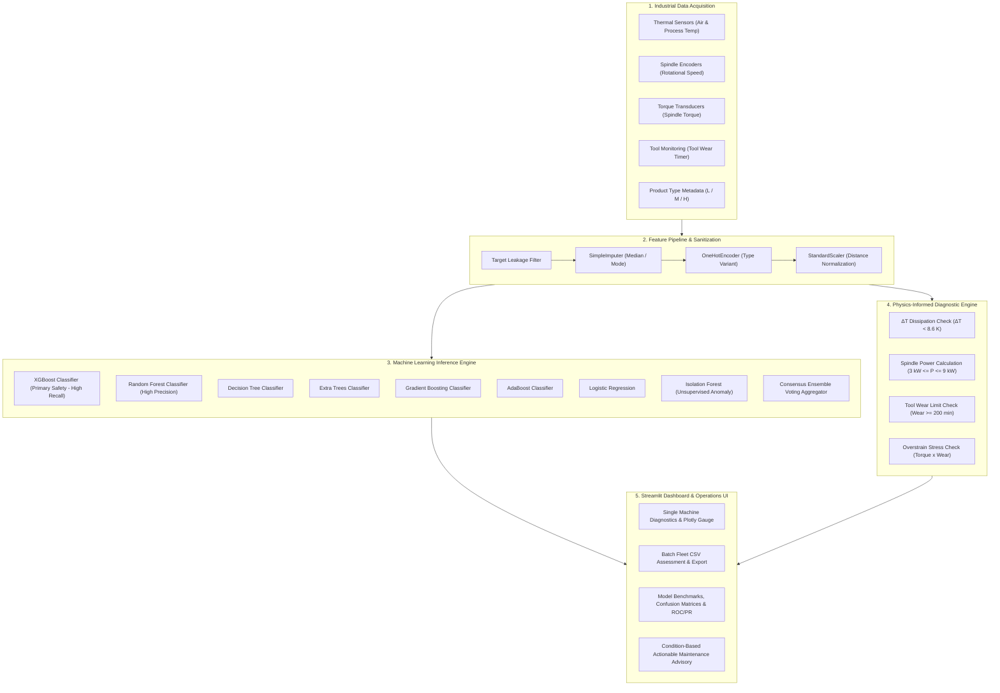

# 🏭 Technical Study & Architecture Report
## AI-Based Industrial Maintenance and Process Optimization System

---

## 1. System Architecture

The AI-Based Industrial Maintenance and Process Optimization System is designed following a modular, five-tier architecture. It separates data acquisition, data sanitation, statistical inference, physical domain modeling, and human-machine interface (HMI) presentation into decoupled, reusable subsystems.

```text
┌────────────────────────────────────────────────────────────────────────┐
│                        1. SENSOR & TELEMETRY TIER                      │
│   Air Temp [K]  •  Process Temp [K]  •  Rotational Speed [rpm]         │
│   Torque [Nm]   •  Tool Wear [min]   •  Product Variant [L, M, H]      │
└───────────────────────────────────┬────────────────────────────────────┘
                                    │
                                    ▼
┌────────────────────────────────────────────────────────────────────────┐
│               2. SANITATION & LEAKAGE-PREVENTION TIER                  │
│   • Target Leakage Filter (Excludes TWF, HDF, PWF, OSF, RNF, UDI)      │
│   • Missing-Value Imputation (Median for numeric, Mode for categorical)│
│   • Categorical Encoding (OneHotEncoder: handle_unknown='ignore')       │
│   • Numerical Scaling (StandardScaler for distance/margin models)      │
└───────────────────────────────────┬────────────────────────────────────┘
                                    │
                                    ▼
┌────────────────────────────────────────────────────────────────────────┐
│              3. DUAL-PARADIGM MACHINE LEARNING INFERENCE               │
│   A. Supervised Failure Classification (7 Pipeline Models)             │
│      [XGBoost, Random Forest, Decision Tree, Extra Trees,              │
│       Gradient Boosting, AdaBoost, Logistic Regression]                │
│   B. Unsupervised Statistical Anomaly Detection                        │
│      [Isolation Forest with contamination tuning]                      │
│   C. Ensemble Consensus Voting Engine                                  │
└───────────────────────────────────┬────────────────────────────────────┘
                                    │
                                    ▼
┌────────────────────────────────────────────────────────────────────────┐
│             4. PHYSICS-INFORMED DIAGNOSTIC REASONING TIER              │
│   • Heat Dissipation Gradient: ΔT = Process Temp - Air Temp (< 8.6 K)  │
│   • Mechanical Power Envelope: P = 2π * (rpm/60) * Torque (3 to 9 kW)  │
│   • Overstrain Index: Overstrain = Torque * Tool Wear                  │
│   • Tool Replacement Limit: Cumulative wear threshold (> 200 min)      │
└───────────────────────────────────┬────────────────────────────────────┘
                                    │
                                    ▼
┌────────────────────────────────────────────────────────────────────────┐
│                5. OPERATIONS & HMI PRESENTATION TIER                   │
│   • Single Machine Real-Time Telemetry & Plotly Radial Gauge           │
│   • Batch Fleet CSV Processing & Annotated Report Generation           │
│   • Benchmark Evaluation (Confusion Matrices & Classification Reports) │
│   • Rule-Based Condition Maintenance Advisory System                   │
└────────────────────────────────────────────────────────────────────────┘
```

### Detailed Tier Breakdown

#### Tier 1: Sensor Telemetry & Ingestion
Captures dynamic, ambient, and mechanical operational readings from industrial milling and turning machines:
- **Ambient & Thermal Readings:** Air temperature $T_{\text{air}}$ and active process cutting temperature $T_{\text{process}}$.
- **Kinematic & Force Dynamics:** Spindle speed $N$ (rpm) and shaft torque $\tau$ ($\text{Nm}$).
- **Tool Lifecycle State:** Cumulative cutting contact time in minutes.
- **Product Quality Tier:** Material grade specification (`L` - 50%, `M` - 30%, `H` - 20%), dictating machining tolerances and tool load stresses.

#### Tier 2: Sanitation & Anti-Leakage Pipeline
Standard machine learning models often suffer from target leakage in industrial benchmarks. This tier enforces strict isolation:
- **Target Leakage Elimination:** The raw AI4I 2020 dataset includes post-failure failure mode labels (`TWF`, `HDF`, `PWF`, `OSF`, `RNF`) and arbitrary indices (`UDI`, `Product ID`). These features are stripped prior to ingestion because they represent diagnostic post-mortems rather than predictive symptoms.
- **Robust Scikit-Learn Pipelines:** Numerical variables pass through median `SimpleImputer` and optional `StandardScaler`; categorical variant indicators pass through `OneHotEncoder(handle_unknown="ignore")`.

#### Tier 3: Dual-Paradigm ML Inference
Combines supervised predictive classification with unsupervised anomaly detection:
1. **Supervised Binary Classifiers:** 7 algorithms trained using cost-sensitive weighting (`scale_pos_weight` and `balanced_subsample`) to overcome the severe 3.39% class imbalance.
2. **Unsupervised Anomaly Detection:** Isolation Forest detects multidimensional sensor outliers without requiring explicit failure labels.
3. **Consensus Ensemble:** Evaluates cross-model agreement to compute consensus probability distributions and eliminate individual model bias.

#### Tier 4: Physics-Informed Diagnostic Reasoning
Machine learning predictions are paired with first-principles physical equations to explain *why* an anomaly or failure is imminent:
- **Thermal Dissipation:**
  $$\Delta T = T_{\text{process}} - T_{\text{air}}$$
  When $\Delta T < 8.6\,\text{K}$, heat dissipation capacity is compromised.
- **Spindle Mechanical Power:**
  $$P = \frac{2\pi \cdot N \cdot \tau}{60} \quad [\text{Watts}]$$
  Standard operational power falls between $3.0\,\text{kW}$ and $9.0\,\text{kW}$. Out-of-band values indicate electrical stall or drive motor overstrain.
- **Overstrain Metric:**
  $$\text{Overstrain} = \tau \cdot \text{Tool Wear} \quad [\text{Nm}\cdot\text{min}]$$
  High torque on a heavily worn tool generates excessive mechanical deflection.

#### Tier 5: Operational Human-Machine Interface (HMI)
Built on Streamlit with custom CSS styling, Plotly visualization widgets, and session state management:
- Single-machine telemetry inspection with preset scenarios.
- Batch fleet assessment capable of scoring thousands of records from CSV uploads.
- Diagnostic advisory converting risk scores into actionable standard operating procedures (SOP).

---

## 2. System Block Diagram



### Component Functionality Matrix

| Block Component | Input Signals | Primary Responsibility | Output Artifact |
| :--- | :--- | :--- | :--- |
| **Data Acquisition** | Physical machinery transducers | Continuous capture of thermal, rotational, and load parameters | Raw telemetry records |
| **Sanitizer Pipeline** | Raw sensor inputs | Prevents data leakage, handles missing values, normalizes distributions | Numerical feature matrix $X \in \mathbb{R}^{n \times d}$ |
| **Supervised Classifiers** | Feature matrix $X$ | Estimates calibrated probability of failure $P(Y=1 \mid X)$ | Class labels & probabilities |
| **Isolation Forest** | Scaled numerical inputs | Isolates observations in sub-spaces to detect rare anomalies | Anomaly flag $\{-1, 1\}$ & offset score |
| **Physics Engine** | Raw physical readings | Evaluates first-principles physical boundary conditions | Domain status flags & metrics |
| **Streamlit Interface** | Inferred predictions & physical telemetry | Interactive operator interface, risk gauges, batch reporting | Visual dashboard & CSV reports |

---

## 3. Programming Languages & Libraries

The system is developed in **Python 3.10+**, selected for its mature scientific computing ecosystem, robust machine-learning libraries, and rapid HMI prototyping frameworks.

### Core Stack & Library Specifications

| Category | Library / Tool | Version Constraint | Architectural Role & Rationale |
| :--- | :--- | :---: | :--- |
| **Language Runtime** | **Python** | `>= 3.10` | High-level execution environment supporting strong typing, context managers, and parallel execution. |
| **Data Manipulation** | **Pandas** | `>= 2.0` | High-performance DataFrame operations, batch CSV reading, and structured feature slicing. |
| **Numerical Processing**| **NumPy** | `>= 1.24` | Vectorized mathematical operations, trigonometry, and physical power calculations. |
| **Machine Learning** | **Scikit-Learn** | `>= 1.3` | Preprocessing pipelines (`ColumnTransformer`, `OneHotEncoder`, `StandardScaler`), evaluation metrics, and classical classifiers (`RandomForest`, `DecisionTree`, `LogisticRegression`, `IsolationForest`). |
| **Gradient Boosting** | **XGBoost** | `>= 2.0` | Extreme Gradient Boosting with GPU/CPU parallelization, tree pruning, and `scale_pos_weight` imbalance compensation. |
| **Model Serialization** | **Joblib** | `>= 1.3` | Efficient binary persistence of trained scikit-learn pipelines and model bundles with minimal disk overhead. |
| **Interactive Dashboard**| **Streamlit** | `>= 1.30` | Production web application framework with reactive state management, caching (`@st.cache_resource`), and UI widgets. |
| **Interactive Charts** | **Plotly** | `>= 5.0` | Vector-rendered interactive web graphics: radial gauge meters, dynamic bar charts, and consensus distribution plots. |
| **Static Visualizations**| **Matplotlib** | `>= 3.7` | Headless generation of high-resolution confusion matrix heatmaps and diagnostic evaluation figures. |
| **Statistical Plotting** | **Seaborn** | `>= 0.12` | Enhanced aesthetic statistical plotting for correlation matrices and class imbalance distributions. |

---

## 4. Future Work & Enhancements

To transition this educational prototype into a mission-critical, production-grade Industrial IoT (IIoT) platform, the following engineering enhancements are planned:

### 1. Edge Deployment & Real-Time Protocol Ingestion
- **Industrial Protocols:** Integrate native industrial protocol adapters including **OPC UA**, **Modbus TCP**, and **MQTT** to ingest sensor feeds directly from Programmable Logic Controllers (PLCs) and Edge Gateways.
- **Edge Inference:** Export trained models to **ONNX** (Open Neural Network Exchange) and optimize execution with **TensorRT** or **OpenVINO** for microcontrollers or embedded edge units (e.g., NVIDIA Jetson, Siemens IPCs).

### 2. Temporal Modeling & Remaining Useful Life (RUL) Estimation
- **Time-Series Deep Learning:** Current classification predicts binary failure states. Transition to sequence-to-sequence models using **Long Short-Term Memory (LSTM)** networks, **Temporal Convolutional Networks (TCN)**, or **Time-Series Transformers**.
- **Prognostic RUL:** Formulate survival analysis and continuous regression targets to compute the exact estimated hours or machining cycles remaining before maintenance is required.

### 3. Multi-Modal Sensor Fusion
- **High-Frequency Vibration Analysis:** Integrate tri-axial accelerometer vibration telemetry processed via Fast Fourier Transform (FFT) and Power Spectral Density (PSD) to detect bearing spalls, gear mesh degradation, and imbalance.
- **Acoustic Emissions & Thermography:** Complement scalar telemetry with acoustic sound spectra and infrared thermographic imaging for holistic machine health evaluation.

### 4. Explainable AI (XAI) & Operator Trust
- **SHAP (SHapley Additive exPlanations):** Integrate live TreeSHAP attribution into the dashboard to show exactly which sensor contributed to the risk score for any given machine.
- **Counterfactual Explanations:** Provide operators with prescriptive recommendations (e.g., *"Reducing spindle speed from 2,800 rpm to 2,100 rpm decreases failure probability from 88% to 14%"*).

### 5. Automated Closed-Loop Control & SCADA Integration
- **Safety Interlocks:** Connect output threshold signals to SCADA systems to automatically trigger automated feed-rate throttling, cooling boost cycles, or controlled emergency stops before catastrophic mechanical fracture occurs.

### 6. Industrial MLOps & Continuous Learning
- **Data & Model Drift Detection:** Implement continuous telemetry monitoring with **Evidently AI** or **Great Expectations** to detect sensor drift, seasonal workshop temperature variations, and tool supplier changes.
- **Automated Retraining:** Deploy automated pipelines using **MLflow** and **Kubeflow** to continuously retrain and version models as new physical inspection logs are validated by maintenance technicians.

